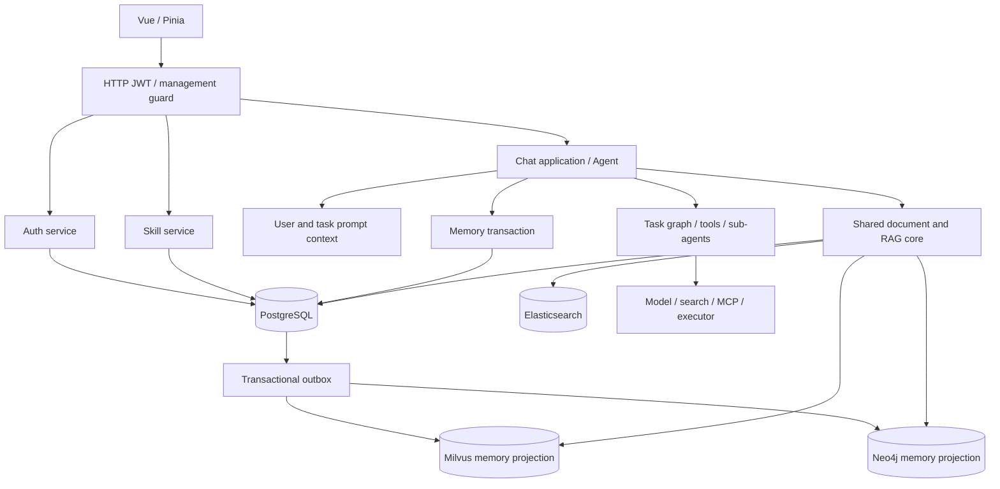

# 请求和存储关系

箭头表示调用或数据关系，不表示每条链路都跨存储原子提交。文档索引与长期记忆 Outbox 是不同的一致性路径。Milvus/Neo4j 同时服务检索和记忆投影，分别受各自仓储语义约束。

启动顺序：加载配置与校验密钥 → 连接服务、初始化 schema → 装配 Agent 与认证 → 绑定监听 → 启动投影/对账工作者 → 服务请求。退出时取消协作任务、排空 HTTP（超时关闭连接）、停止后台工作者并释放持有的客户端；不承诺不可取消操作立即终止。
