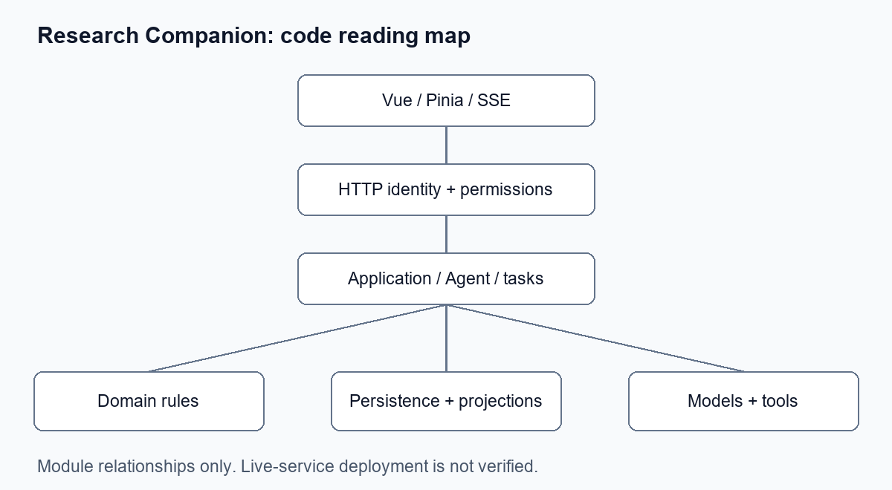

# 项目阅读与排查指南

从一条请求开始阅读，不需要先理解所有数据库。

1. 阅读 [根 README](../../README.md) 中的启动条件与验证范围。
2. 查看 [架构索引](../architecture/ARCHITECTURE_DOCS_INDEX.md)，定位入口、应用和存储。
3. 从 `internal/interfaces/http/handler/` 追踪一个已认证请求，确认用户上下文与管理权限。
4. 阅读 `internal/application/chat/` 的模式分发、上下文与工具，再深入所需领域。
5. 从具体测试建立输入、成功/失败结果和副作用的预期，再修改代码。

[SKILL.md](SKILL.md) 提供阅读步骤；references 下的清单分别覆盖架构、业务映射、排错、术语和学习路径。项目图为本仓库新绘制的模块示意，不含个人平台截图。
